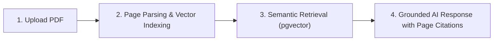
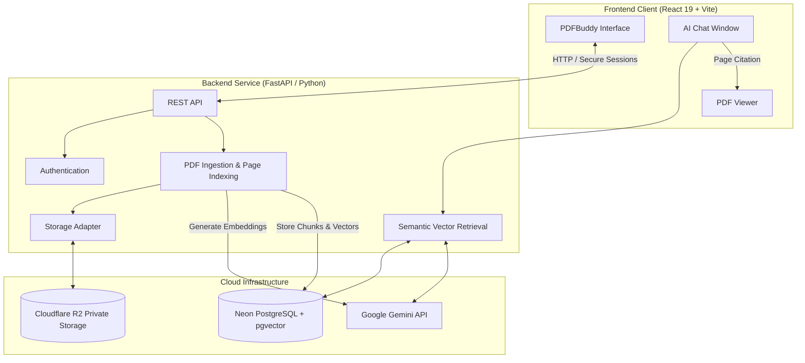

# PDFBuddy

### Your PDFs. Understood.

An AI-powered PDF chat and document intelligence platform that helps you understand, explore, and retrieve information from your documents through natural conversations.

[Live Demo](YOUR_LIVE_DEMO_URL) · [GitHub Repository](YOUR_GITHUB_REPOSITORY_URL) · [Author Profile](https://github.com/kamalsharma001)

---

## About PDFBuddy

Reading lengthy technical reports, financial statements, research papers, and legal documents is tedious and inefficient. Finding specific answers across hundreds of pages often means relying on keyword searches that miss critical context.

PDFBuddy transforms static PDFs into interactive conversational workspaces. By combining page-aware document parsing, vector search, and Google Gemini AI, PDFBuddy delivers answers grounded directly in uploaded documents. Every response includes page-level citations that allow users to navigate directly to the source material.

---

## Key Features

- **AI-Powered Conversations:** Ask questions about uploaded documents using natural language.
- **Context-Aware Retrieval:** Semantic vector search retrieves relevant document passages.
- **Page-Level Citations:** AI answers include clickable page citations that navigate to referenced pages.
- **Interactive PDF Viewer:** Embedded reader with page navigation, page jumping, and zoom controls.
- **Document Management:** Upload, search, organize, and delete documents.
- **Multi-Document Workspaces:** Manage independent documents and conversation histories.
- **Secure Authentication:** Google OAuth 2.0 and email/password authentication with Argon2id password hashing and HttpOnly JWT sessions.
- **Private Document Storage:** Cloudflare R2 object storage with pre-signed URLs and a local disk fallback for development.

---

## How It Works



1. **Upload:** Select or drag and drop a PDF file. The current upload limit is 50 MB.
2. **Index:** Text is extracted page-by-page using pypdf, divided into chunks, and converted into 768-dimensional embeddings.
3. **Retrieve:** When a question is asked, PDFBuddy searches relevant document chunks in Neon PostgreSQL using pgvector.
4. **Answer:** Google Gemini generates a contextual answer grounded in retrieved passages, with page-level citations.

---

## Architecture



---

## Technology Stack

| Layer | Technologies |
| :--- | :--- |
| **Frontend** | React 19, Vite, JavaScript (JSX) |
| **Backend** | Python, FastAPI, Uvicorn, asyncpg |
| **AI & Ingestion** | Google Gemini, pypdf, vector embeddings |
| **Database & Vector Search** | Neon PostgreSQL, pgvector |
| **Object Storage** | Cloudflare R2, S3-compatible API |
| **Authentication** | Google OAuth 2.0, Argon2id, JWT sessions |
| **Deployment** | Vercel, Render, Docker |

---

## Project Structure

```text
pdfbuddy/
├── README.md
├── .env.example
├── .gitignore
├── .dockerignore
├── docker-compose.yml
├── render.yaml
│
├── backend/
│   ├── Dockerfile
│   ├── pyproject.toml
│   ├── requirements.txt
│   ├── neon_schema.sql
│   ├── .env.example
│   │
│   ├── app/
│   │   ├── main.py
│   │   ├── config.py
│   │   ├── deps.py
│   │   ├── schemas.py
│   │   │
│   │   ├── api/
│   │   │   ├── auth.py
│   │   │   ├── documents.py
│   │   │   └── chat.py
│   │   │
│   │   ├── db/
│   │   │   ├── postgres.py
│   │   │   └── repositories.py
│   │   │
│   │   └── services/
│   │       ├── auth_service.py
│   │       ├── gemini_client.py
│   │       ├── pdf_ingestion.py
│   │       ├── retrieval.py
│   │       └── storage.py
│   │
│   └── tests/
│       ├── test_pdf_ingestion.py
│       └── test_routes.py
│
└── frontend/
    ├── index.html
    ├── package.json
    ├── vite.config.js
    ├── vercel.json
    ├── .env.example
    │
    ├── public/
    │   ├── favicon.svg
    │   └── brand/
    │       ├── logo.svg
    │       └── symbol.svg
    │
    └── src/
        ├── main.jsx
        ├── index.css
        ├── App.jsx
        ├── App.css
        │
        ├── lib/
        │   ├── api.js
        │   └── router.js
        │
        ├── components/
        │   ├── Logo.jsx
        │   ├── DocumentSidebar.jsx
        │   ├── ChatWindow.jsx
        │   ├── PDFViewer.jsx
        │   └── UploadPanel.jsx
        │
        └── pages/
            ├── LandingPage.jsx
            ├── AuthPage.jsx
            └── AppPage.jsx
```

**Key Directories:**
- `backend/app/api/` — API endpoints.
- `backend/app/db/` — PostgreSQL connection and data access.
- `backend/app/services/` — Authentication, AI, PDF processing, retrieval, and storage logic.
- `backend/tests/` — Backend test suite.
- `frontend/src/components/` — Reusable UI components.
- `frontend/src/pages/` — Application pages.
- `frontend/src/lib/` — Frontend utilities and API client.

---

## Quick Start

### Prerequisites

- Python 3.10+ (tested with Python 3.12)
- Node.js 18+ and npm
- Git

### 1. Clone the Repository

```bash
git clone YOUR_GITHUB_REPOSITORY_URL
cd pdfbuddy
```

### 2. Backend Setup

```bash
python -m venv .venv
```

Windows PowerShell:
```powershell
.venv\Scripts\Activate.ps1
```

macOS / Linux:
```bash
source .venv/bin/activate
```

Install dependencies:
```bash
pip install -r backend/requirements.txt
```

Configure backend environment:
```bash
# Copy backend/.env.example to backend/.env
cp backend/.env.example backend/.env
```

### 3. Frontend Setup

Open a new terminal:
```bash
cd frontend
npm install
```

Copy `.env.example` to `.env` and configure the frontend API URL:
```bash
cp .env.example .env
```
Ensure `VITE_API_URL=http://localhost:8000` is configured in `frontend/.env`.

### 4. Database Setup

1. Create a PostgreSQL database on [Neon](https://neon.tech).
2. Enable the `vector` extension.
3. Execute the SQL in `backend/neon_schema.sql` using the Neon SQL Editor.
4. Add your database connection string as `DATABASE_URL` in `backend/.env`.

### 5. Start Development Servers

**Backend:**
```bash
cd backend
uvicorn app.main:app --reload --host 0.0.0.0 --port 8000
```

Backend health check:
`http://localhost:8000/health`

**Frontend (in a separate terminal):**
```bash
cd frontend
npm run dev
```

Open the local URL printed by Vite, normally `http://localhost:5173`.

---

## Configuration

PDFBuddy requires external credentials for full functionality:

- **Neon PostgreSQL:** `DATABASE_URL`
- **Google Gemini API:** `GEMINI_API_KEY`
- **Google OAuth 2.0:** `GOOGLE_CLIENT_ID`, `GOOGLE_CLIENT_SECRET`
- **Cloudflare R2:** `R2_ACCOUNT_ID`, `R2_ACCESS_KEY_ID`, `R2_SECRET_ACCESS_KEY`, `R2_BUCKET_NAME`

Google OAuth and R2 are optional in local development (email/password authentication works without Google credentials, and storage falls back to the local `./uploads` directory).

Never expose secrets in frontend environment variables or commit local `.env` files.

---

## Testing

**Backend:**
```bash
$env:PYTHONPATH="backend"; python -m pytest backend/tests -v
```

**Frontend production build:**
```bash
npm run build --prefix frontend
```

---

## Author

**Kamal Sharma**

[GitHub Profile](https://github.com/kamalsharma001)
